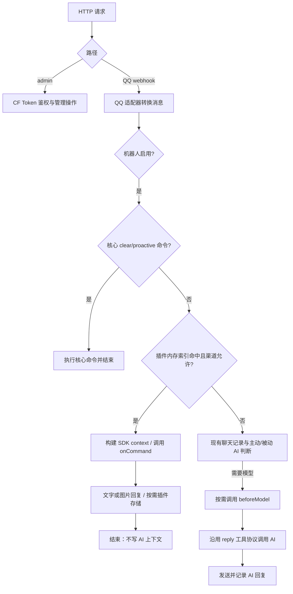
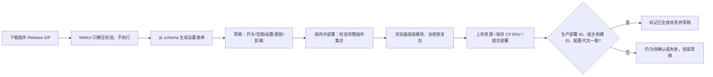

> 当前版本说明：本文包含按历史版本描述的设计。当前 0.8.6 首装默认插件列表为空，/sys 和 /help 由关键词提供；升级恢复用户完整安装集合。

## 仓库与构建结构

```text
qq-bot-webhook/                       私有核心
├── pages/_worker.js/index.js         createBot 工厂
├── pages/_worker.js/dispatch.js      核心命令 → 插件索引 → AI
├── pages/_worker.js/plugin-system/
│   ├── runtime.js                   SDK 能力、命令索引、beforeModel
│   ├── protocol.js                  SDK v1 管理阶段验证（同步副本）
│   └── crypto.js                    恢复产物加密
├── pages/_worker.js/admin/plugins.js 管理鉴权后恢复包及密钥合并
├── bundled-plugins/essentials-1.0.2/  历史公共插件包（可选）
├── schema.sql                       plugin_kv + 一次性旧数据迁移
└── dist/qq-bot-release.json          单独编译的 core ESM
qq-bot-webui/                         Vercel 静态前端
├── public/plugin-system/manager.js   安装、表单、草稿、启停、升级、卸载
├── public/plugin-system/packages.js  ZIP 检查与部署组装
└── public/deploy.js                  保存 ENV + 上传多模块 bundle
qq-bot-plugin-sdk/                    公共 SDK（无核心代码）
├── src/index.d.ts                    类型契约
├── src/protocol.js                   包与配置协议
├── src/testing.js                   作者测试助手
└── bin/qq-plugin.mjs                 esbuild + ZIP
qq-bot-plugin-daily/                  公共插件 → daily-1.0.2.zip
qq-bot-plugin-essentials/             公共插件 → essentials-1.0.2.zip

部署时：
_worker.bundle
├── metadata                         main_module=bootstrap.mjs
├── bootstrap.mjs                    导入 core 与启用插件、配置快照
├── core.mjs                         私有仓库编译产物
├── plugin-daily.mjs
└── plugin-essentials.mjs
静态资源：/_release/installation.enc   包含核心/全部插件/普通配置的加密恢复包
CF Secret：PLUGIN_ARTIFACT_KEY         当前部署解密密钥
CF Secret：PLUGIN_SECRETS_JSON         插件密钥（不进入上面代码）
D1：plugin_kv                         (plugin_id,key) 联合主键
```

## 一条消息如何执行





## 默认预装与紧凑面板

v0.5.1 构建时在 dist/modules 中将 core.mjs 和独立的 plugin-essentials.mjs 组装起来，默认启用系统信息与帮助 1.0.0。首次 qq-bot-pages.zip 将该入口打包为单个 _worker.js，保留 CF 控制台拖放上传兼容性。核心更新 JSON 始终只包含独立核心；WebUI 后续部署继续使用多个 ESM 模块。受保护的 installation.json 保存同一个插件包和默认配置，WebUI 可正常读取、停用或卸载。

默认列表只属于首次部署入口，核心工厂和后续 WebUI 部署不自动填充默认插件。用户卸载后，保存配置或更新核心均保留空列表。每日人品与图片仍从独立插件 Release 安装。

WebUI 的插件设置默认折叠，启停使用带键盘支持和 aria-checked 状态的 switch，上传入口使用统一的主按钮。展开状态在本次面板操作中保留，重新连接或刷新时恢复折叠。

## 插件 Markdown 消息(0.8.0)

- 能力声明:插件在 `plugin.json` 的 `permissions` 中加 `reply.markdown`;这是"请求",不是"授权"。
- 授权开关:安装项上的 `markdown` 布尔字段(默认缺省=false),由 WebUI「插件设置」的「Markdown 消息」复选框管理,随安装集合加密保存并部署;同一 ID 更新/重装时保留。
- 运行时暴露:只有"清单声明 + 安装项授权"同时满足,`ctx.reply.markdown(text)` 才存在;否则为 `undefined`(插件用 typeof 判断降级)。与 text/image 共用每命令 3 次回复预算;内容 1~4000 字符,拒绝控制字符(\t \n \r 除外),`\r\n`/`\r` 由适配器归一为 `\n`。
- 边界:AI 模块没有任何 Markdown 发送路径;Markdown 回复不经 dispatch 的落库包装,不写 messages 表(与 replyImage 相同)。
- 兼容:0.8.0 之前的核心按旧权限表校验,声明 `reply.markdown` 的插件会被明确拒绝(插件权限无效),不会静默装不上或装上后静默失败;WebUI 的 `composeInstallation` 在目标核心发布包不含 `pluginMarkdown: 1` 时停止部署并提示先升级后端。`qq-bot-release.json` 新增 `pluginMarkdown: 1` 字段,旧前端忽略。
- QQ 协议:适配器 `sendMarkdown()` 发送 `msg_type=2` 且 `markdown.content` 必填,不能再带 `content`/`ark`(50037/22006);失败抛错并携带 QQ 错误码。细节见 docs/qq-api-notes.md。

## 数据与失败恢复

`schema.sql` 新增 plugin_kv / plugin_migrations。迁移标记 daily-v1 防止以后重跑初始化时恢复已重置的人品记录。daily 的 key 为 fortune:<sender> / picture:<work>，每日原子写防止并发出现两个人品值或今日图。原表不删除，以便部署回滚。

卸载不删除存储。只支持同 ID 更新、保留兼容普通配置，缺失字段补默认值；配置类型变更会提示并恢复默认值，必填项在启用部署时验证。当前没有插件依赖解析、跨插件调用、市场自动安装、任意配置嵌套或不可信代码沙箱。

密钥保持/替换/删除由管理端合并，默认响应仅带存在状态。代码与恢复包不含插件密钥。本地 IndexedDB 仅保存包和普通配置，按部署 ID 恢复草稿；密钥修改只在内存中，刷新需重填。

CF ENV PATCH 与 Pages 部署不是原子事务；状态面板不会在只完成 PATCH 时宣称生效。失败后原部署仍带其原 ENV 与恢复包，可重新部署。若上一轮更改了密钥且尚未生效，为防止用旧密钥覆盖新密钥，需要先完成/恢复上次部署再合并密钥修改。多管理员版本检查不是分布式锁。

Cloudflare 控制台 rollback 会恢复旧代码与对应运行 ENV，但 D1 数据不会回滚；还应核实项目当前保存的配置是否与恢复的运行版本一致。手工覆盖 dist/pages 会恢复首次部署的默认插件集合，日常升级使用 WebUI 保留安装集合。

## 性能与安全边界

插件密钥 ENV 总量最多 5000 UTF-8 字节，完整加密恢复包最多 1 MiB。最多 8 个插件，单模块 128 KiB、总模块 512 KiB、单 ZIP 256 KiB。SDK 限制单命令 3 次回复、8 次存储、4 次 HTTPS GET，HTTP 响应最多 1 MiB。上限只控制常见误用，不保证满足 CF 免费层 CPU。

静态初始化建立 exact/prefix 两张 Map。匹配只查消息本身和首词，无逐插件正则/配置数据库扫描。beforeModel 只进入已有 AI 调用分支，命令或关闭 AI 时不调用。包校验、解压、加密和组装在管理流程，不能出现在聊天热路径。

同一个 Worker 内插件可直接使用 JavaScript 全局能力，SDK 声明权限不是隔离恶意代码的安全沙箱。同步死循环会影响整条请求；不要安装不可信包。网络等待不计 CPU，计算及 waitUntil 计算计入总 CPU。免费额度需实际 CF 指标验证，不能以本地耗时承诺 10ms 内必定执行。

恢复文件公共访问返回 404，重新部署时使用 AES-GCM 加密；编辑权限持有者可以获取编译核心，编译与压缩不能防止逆向。首次核心 ZIP 中的恢复文件受路径路由保护，不应单独复制到公开静态站点。

## Markdown 按钮（核心 0.8.1 / SDK 1.4.0）

保留 `ctx.reply.markdown(text)`，新增 `ctx.reply.markdown(text, { keyboard: { rows: [{ buttons: [...] }] } })`。插件必须同时声明 `reply.markdown`、`reply.keyboard`，管理员须分别开启「Markdown 消息」「Markdown 按钮」授权。默认均关闭；关闭 Markdown 同时撤销按钮。安装项 `keyboard: true` 随完整安装集合加密恢复、更新保留；按钮与文字、图片、Markdown 共用每次调用三条回复预算。`ctx.reply.keyboard === true` 用于能力降级判断。

```ts
await ctx.reply.markdown('# 按钮演示', { keyboard: { rows: [{ buttons: [
  { id: 'help', render_data: { label: '帮助', visited_label: '再次查看', style: 0 },
    action: { type: 2, permission: { type: 2 }, data: '/help', enter: true,
      reply: true, unsupport_tips: '请手动发送 /help' } },
  { id: 'confirm', render_data: { label: '确认', visited_label: '已确认', style: 1 },
    action: { type: 1, permission: { type: 2 }, data: 'confirm', unsupport_tips: '请升级 QQ' } },
] }] } });
```

指令按钮（type=2）沿用普通消息命令分发。回调按钮（type=1）须定义 `onInteraction(ctx)`：通过 `ctx.interaction.buttonId/data` 处理业务，尽快 `await ctx.interaction.respond(0)`，再通过 `ctx.reply` 发送后续消息。响应码 0 成功、1 失败、2 频繁、3 重复、4 无权限、5 仅管理员；每个互动只能回应一次。未手动回应时，核心在处理成功后自动回应 0，异常回应 1，未知/未授权/停用/越范围回调回应 4。回应已尝试后不会因网络异常重试。互动独立于聊天、AI、MCP 和 messages 历史。

键盘最多 5 行，每行 5 个按钮，单条消息内 ID 唯一（1..64 UTF-8 字节），label/visited_label 1..80 字节、style 0/1；data 1..512 字节，unsupport_tips 1..200 字节。只接受文档字段，支持 permission.type 0 指定用户（1..10 个 specify_user_ids）、1 管理员、2 所有人；群聊/私聊不支持频道身份组。reply/enter 只支持指令按钮；不支持模板、跳转、anchor 和弃用字段。核心对回调 data 加 HMAC 签名后以 QQ keyboard.content 发送，插件读取的是原始 data；签名绑定插件版本、会话、按钮 ID、指定用户，签名密钥轮换或插件升级会使旧按钮失效。QQ 执行管理员权限校验；核心再次检查指定用户。

核心在单个 isolate 内对五分钟内最多 256 个互动 ID 去重，不能保证跨 isolate 的 exactly-once。涉及持久状态的业务须自己做幂等处理。回调 handler 与命令一样必须 await 所有异步操作，不应在回应前执行慢任务。

发布包与管理 capabilities 声明 `pluginKeyboard: 1`；目标核心没有该标记时，浏览器在保存配置前拒绝声明按钮的插件。旧核心固定权限表也会拒绝。0.8.1 后端要求按钮安装集合的部署计划带 `keyboardPlan: 1`，阻止旧控制台更新时丢失授权。三份 protocol.js（核心、WebUI、SDK）必须字节一致。

QQ 需订阅 `INTERACTION_CREATE`（INTERACTION intent `1 << 26`），互动 type 11/12 使用 `PUT /interactions/{d.id}` 回应；其他类型不发 PUT。后续群聊/私聊消息使用外层事件 `payload.id` 作为 event_id，不能当 msg_id。官方自定义按钮标为「内邀开通」：普通 Markdown 可用不代表账号已开通自定义键盘。开通权限、事件订阅和客户端显示仍须 QQ 平台实际验证。

官方依据：[消息按钮](https://bot.q.qq.com/wiki/develop/api-v2/server-inter/message/trans/msg-btn.html)、[互动事件](https://bot.q.qq.com/wiki/develop/api-v2/autogen/event/interaction_create.html)、[回应互动](https://bot.q.qq.com/wiki/develop/api-v2/autogen/api/interactions_interaction_id.put.html)。

0.8.6 起首次部署入口默认插件列表为空，系统信息与帮助由默认关键词规则提供；后续升级始终恢复用户完整安装集合，已装 Essentials 保留。
