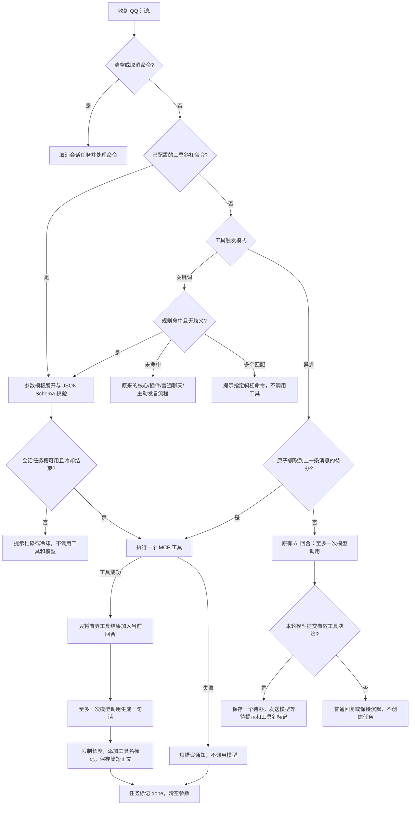

这套设计适合目前的 Pages 无服务器运行方式：保持异步预约，新增纯程序直接触发；每个消息事件最多一次模型请求，每次任务只尝试一个外部工具，不新建表、不启动常驻进程。关键词模式把一次工具请求和一次模型请求放在同一个事件里，因此工具超时仍可能用尽总时间预算。

## 五项改动

| 问题 | 实现 |
| --- | --- |
| 工具回答过长，进入历史后反复复述 | 输出默认限制 256 tokens，提示只说一句；发送前提取第一句，再限制为 120 个 Unicode 字符。未遵守提示也无法发长篇。 |
| 不想把工具回答带入后续聊天 | 默认开启忽略工具回答上下文；在已有历史查询结果中过滤 `source=mcp`，包含旧记录，不增加一次查询、不删除原记录。 |
| 模型说正在查，实际上没有调用 | 等待提示由模型根据问题和人格生成，只在任务保存成功后发送；程序追加 `【使用了工具 - 服务名/工具名】`，清除模型伪造的新旧格式标记。未选择工具时无论开关是否开启都不显示标记，常见虚假等待承诺仍会被拦截。 |
| 服务商说明诱导频繁调用 | 每个工具可开启自定义说明，完整替换原 description；同时删除输入结构中 description/title/examples 等说明性注释，保留真实参数约束。留空表示移除说明。 |
| 希望手动或关键词直接调用 | 每工具设置一个斜杠命令、JSON 参数模板及最多 4 条规则。直接执行时不让模型先判断，只调用一次模型生成短答。 |

0.7.1 的标记只标识本次选用的工具，不表示执行成功：异步等待阶段仍是预约；0.8.5 起自动续办，失败时保留用户消息触发路径，失败会在正文中说明；它也不证明网页内容或模型结论一定真实。模型仍可能编造事实或选择不合适的工具。要求可控调用时应选关键词模式或使用明确的斜杠命令。

忽略上下文开启后，模型将不能依靠上次工具回答来回答“上面那个呢”。原始工具资料始终只用于当前整理回合，不写入聊天历史或任务表。短答仍保留用于聊天记录和原有主动发言统计；通知不落库。用户把资料复制进聊天，仍按用户消息处理。

## 消息流程



核心/插件命令优先权保留，工具斜杠命令不能占用它们的名字。在异步模式中，普通核心/插件命令仍可同时触发已有待办；`/clear`、`/mcp-cancel` 优先取消。手动工具命令遇到已有待办会提示占用，不覆盖或追加任务。

模型预约指令明确标出当前消息，要求只为当前消息新建任务，不能补办历史中的旧搜索。普通消息不通过关键词时，关键词模式不向模型提供 MCP 路由字段，也不访问 MCP 任务槽。

## WebUI 配置

进入「MCP服务」。服务设置和每工具设置默认折叠，启停使用开关。变更仍通过「保存并部署」应用。

| 配置 | 默认 | 范围或作用 |
| --- | --- | --- |
| 工具触发模式 | 异步 deferred | 可切换 keyword；切换部署产生新配置 generation，旧任务不再执行 |
| 忽略工具回答上下文 | 开 | 同时过滤旧 source=mcp 记录 |
| 显示程序生成的工具状态 | 开 | 只在选用工具时显示，标记不写入模型历史 |
| 工具回答 Token 上限 | 256 | 64～512，包含模型结构化回答开销 |
| 工具回答字符上限 | 120 | 40～240，只取第一句，不输出长 URL/列表 |
| 直接调用冷却 | 60 秒 | 1～600 秒，按会话、从任务启动时间起算；跨工具共用 |

Token 太小可能截断模型 JSON；此时用一句简短资料节选兜底并注明未经核验，不追加模型请求。AI 总开关关闭时，明确的直接工具调用可执行并返回资料节选，不调用模型。

### Exa 搜索示例

工具：`web_search_exa`。具体必填参数以检测到的参数结构为准；当前服务要求 query 和 objective，因此不能只填写 query。

斜杠命令：`/search`

自定义说明建议：

> 查询公开网页中的实时信息。仅在用户明确要求联网，或需要核实最新事实且上下文没有答案时使用；闲聊、已有答案追问不用。numResults 填 3，objective 简短描述要核实的事实。一次查询足够，不因工具说明要求而继续调用。

参数模板：

```json
{
  "query": "{{input}}",
  "objective": "查询与用户问题直接有关的最新可靠信息，优先原始来源；只提取足以写一句简短回答的事实。",
  "numResults": 3
}
```

任何模式下，`/search 冰雪奇缘最新官方消息` 都直接调用。群聊是否能收到不带 @ 的命令，仍取决于 QQ 全量消息订阅。

关键词模式示例：规则类型选「整条正则」，开启「必须 @ 机器人」：

```text
^(?:帮我搜索|帮我查一下|搜索)\s+(.+)$
```

它会命中 `搜索 冰雪奇缘最新官方消息`，把捕获的文本填到 query；不会命中 `我刚才说搜索什么来着`。普通前缀规则 `帮我搜索` 要求后面是空格、冒号或结束，防止误匹配 `帮我搜索功能怎么用`。请先用「本地触发预览」查看命中和展开参数，预览不会调用远程服务；线上还会校验范围、完整参数类型和任务状态。

正则使用 RE2 而非原生回溯引擎，不支持环视和回溯引用。每条最长 160 字符、最多 9 个捕获组；单项计数重复不超过 64、保守总展开量不超过 256；启用规则总数最多 24，正则最多 8；只匹配最多 512 字符的消息。前缀或正则匹配前会忽略引用、引号、代码、否定开头的消息。规则不能理解所有复杂语义；避免 `.*` 之类宽泛规则，开启必须 @ 可进一步降低误触发。

### 其他工具

JSON 模板按结构替换字符串，不拼接 JSON 源码、不执行 JavaScript：

| 变量 | 含义 |
| --- | --- |
| `{{input}}` | 斜杠命令后面的文字；前缀后文字；正则第 1 个捕获组（无组则整条） |
| `{{message}}` / `{{match}}` | 整条消息 / 匹配内容 |
| `{{1}}`～`{{9}}` | 正则捕获组，替换为字符串 |
| `"{{number:input}}"` / `"{{number:1}}"` | 输入文字 / 第 1 组转换成数字，必须作为整个模板值 |
| `"{{boolean:input}}"` / `"{{boolean:1}}"` | 输入文字 / 第 1 组转换成 true/false，必须作为整个模板值 |

数值工具示例：命令 `/calc`，正则 `^计算 (\d+)$`，参数 `{"value":"{{number:input}}"}`；`/calc 21` 和 `计算 21` 均传入数字 21。直接使用 `{{1}}` 的模板依赖捕获组，只适用于正则；希望与斜杠命令共用时优先采用 `{{input}}`。缺失参数、类型错误、多个不同匹配都不会发出工具请求。单个必填字符串字段的工具会自动提供 `{{input}}` 默认模板，复杂工具需要明确配置。

## 状态、成本和故障边界

- 复用 `mcp_tasks` 现有行：直接模式通过一个条件 UPSERT 原子占槽，再检查取消状态、执行、完成。活动任务互斥，冷却和最近来源消息 ID 防止短时间重复调用；进程中断不自动重试。它不是无限期的消息去重日志。
- 未命中关键词不查询这个表；普通聊天的原有上下文读写、主动发言判断仍然存在。异步模式的条件领取查询保持原样。不能把“没有增加上下文查询”理解为零 D1 消耗。
- 忽略上下文在原有最近 N 条消息的结果中过滤，不另查一批补满 N 条。没有数据库迁移或新表。直接任务的真实读写要按 D1 rows_read / rows_written 计量，不能简单按 SQL 次数算行数。
- 同一事件总预算 25 秒。MCP 默认 8 秒、可设到 12 秒；请求初始化和调用共用工具预算，随后一次模型请求和 QQ 发送共用剩余时间。慢服务可能超时；不会靠增加第二次模型请求来补救。
- 免费层 CPU 为纯计算时间，网络等待与它不同；RE2 和输入边界降低风险，但校验、JSON、签名、冷启动仍有成本。本地通过测试不能证明所有线上请求都低于 10ms，参见 [官方限额与本项目说明](/docs/cloudflare-limits/)。
- `【使用了工具 - …】` 是工具名标记，具体执行结果见正文；模型失败时仍可能是未经核验的节选。事实幻觉和外部错误信息无法仅靠短答或状态标记根除。

## 兼容与参考

核心能力新增 `mcpControls: 1`；新面板按后端能力显示，新配置嵌入可恢复的部署包。前端发送 `mcpPlan.version: 2`，后端拒绝会丢弃已有自定义配置的旧客户端保存；带高级工具配置时也拒绝部署到不支持它们的旧核心。重新检测工具保留自定义说明、命令、模板、规则；参数结构变化时停用该工具供检查。

参考 AstrBot 的 `tool_loop_agent_runner.py::_materialize_large_tool_result` 对工具原文设上限的思路；它会把超限结果转存文件供之后读取，本项目没有移植文件存储或追加读取工具。MaiBot 的 `host_llm_bridge.py::_build_tool_result_item` 将工具内容作为独立的工具结果项，其“汇总”主要是拼接内容，并不自动保证短答。本项目使用本回合临时资料、显式 source 标识和历史过滤，适应无服务器单次请求与现有 D1 结构。
